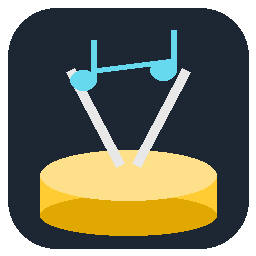

#  Jam Band

A band you lead with your voice. Ask for drums, and the drums start. Ask for
a bass, and it comes in on the next bar. Ask for the whole band, and you get
the whole orchestra. Emkay comments as it goes, then listens again.

```
"let's jam"                     "Let's jam! A swing in F major. What do we start with? Drums?"
"drums"                         the drums start - "Yeah! That's good."
"and now a bass"                "Ohhh, listen to that bass!"
"the whole band"                "And now... the whole orchestra!"
"faster" / "slower" / "tempo 120"
"make it reggae" / "in G minor"
"no more piano"
"let's finish"                  one big last chord - "Thank you, thank you!"
"stop"                          stops at once

"lad os jamme en blues i e"     (Danish)
"sæt bassen ind", "hele bandet", "hurtigere", "lad os slutte"
```

You can also say it all at once: "jam a funk in E minor with drums and
bass", or "jam a blues at 100".

### Moments

```
"a sax solo" / "a solo"         an instrument improvises for a round of the chords
"a drum solo"                   the drummer's turn
"a break"                       everyone hits the one, then silence - and back in
"from the top"                  the chords start again
"an intro"                      the last bars lead in, then the top
```

### Your melody

```
"here's my melody"              "Let me hear it!" - hum it, sing it, whistle it,
                                or play it on a MIDI keyboard
"the notes are C D E C"         or "do re mi do", in your language's note names
"the melody on sax"             who plays it
```

Emkay works out the notes, the key they are in, and chords that suit them,
and the band plays your melody with you. A hummed tune is followed by its
pitch, cut into notes, put in tune (the key it is in, however you hum) and
put in time (the jam's tempo, or the one you hummed at).

### Tunes everybody knows

```
"jam a reggae over Frère Jacques"
"a bossa over Ode to Joy"       "now Jingle Bells"
"what tunes do you know?"
```

The library has tunes that are free to use: traditional songs and nursery
rhymes, and themes by composers who died long ago (Beethoven, Mozart,
Grieg ...). Each has its name in every language, so "Mester Jakob", "Bruder
Jakob" and "Fra Martino" all find Frère Jacques. With
[ovos-skill-karaoke](https://github.com/emkay-voice/ovos-skill-karaoke)
installed, its songbook comes too: "a tango over Hey Emkay".

### Let Emkay lead

```
"help me make a jam"            Emkay asks: which style? which key? - starts
                                the drums and offers the bass, the piano ...
                                one by one ("yes" / "no")
"surprise me"                   Emkay's own jam: a tune from the library, a
                                style, an intro, the tune, solos, a break,
                                maybe a key change, and the ending
"surprise me with tango"
```

Say anything while Emkay's own jam plays and it is yours to change.

### Saving

```
"let's finish"                  ... "Shall I save that jam?" - "yes" - "Friday blues"
"save it as Friday blues"       while it plays
"play my jam Friday blues"      played as it was; say something, and it's yours again
"what jams do I have?"
"delete the jam Friday blues"
```

A saved jam is everything that happened, bar by bar, so it plays back
exactly - and when you change it halfway and save it again, you have edited
it. Each saved jam is also written as a Standard MIDI File next to it, to
open in any music program (or play with ovos-phal-plugin-midi). A few jams
come with the skill: Coffee blues, Emkay's Swing, Kitchen tango, Funky Mozart
and Reggae Jacques.

It speaks every language Emkay does: English, Danish, German, Spanish,
French, Italian, Dutch, Portuguese (Portugal and Brazil), Catalan, Basque and
Galician. It understands keys as letters (D, F sharp, B flat; and Danish and
German H, B, Fis, Es) or as solfège (re, si bemol), with major and minor.

[](https://github.com/emkay-voice/ovos-skill-jamband/actions/workflows/publish.yml)
[](https://pypi.org/project/ovos-skill-jamband/)

## The styles

| Style | The groove | Key, tempo |
|---|---|---|
| swing | ride cymbal, walking bass, Charleston piano, sax and brass punches | F, 140 |
| blues | 12-bar shuffle, boogie bass, organ | E, 92 |
| rock | eighth-note bass, power chords | A, 120 |
| pop | I-V-vi-IV, piano on every beat | C, 104 |
| funk | sixteenths, slap bass, muted guitar scratch, horn stabs | E minor, 104 |
| disco | four on the floor, octave bass, strings | A minor, 120 |
| reggae | one drop, the skank on 2 and 4, organ bubble | G, 76 |
| bossa | rim-click pattern, nylon guitar, Rhodes | C, 128 |
| tango | the bandoneon marking every beat, then the 3-3-2, the bass dragging into 3 | D minor, 112 |

Every part has its own groove in every style: drums, bass, piano, guitar,
organ, strings, brass, sax and bandoneon. "The whole band" brings in the
style's own band, part by part. A key you ask for stays when you change the
style. The style's default key changes it only if you never chose one.

The screen shows the chord now, big, the next ones, and who is playing -
and who solos, a break, and the melody.

## The band behind it

The music is played by [ovos-phal-plugin-midi](https://github.com/emkay-voice/ovos-phal-plugin-midi),
the device's MIDI instrument. It is installed with the skill and runs in
OVOS' PHAL service, so restart OpenVoiceOS once after installing. Emkay
starts it by itself. Until it runs, the skill says its band isn't ready.

The jam sends the plugin the next bar while this one plays. When you change
something, the bar already sent is taken back (`ovos.midi.cancel`) and sent
again, changed. That is why a change is heard on the next bar line and the
music never stops. While OVOS speaks or listens, the plugin turns the music
down.

How it sounds is up to the plugin. Its own synth needs nothing. With
FluidSynth and a SoundFont it plays real instrument samples. It can also play
a real instrument plugged into the device. See its README.

To hear a hummed melody the skill uses the listener's recording mode
(`recognizer_loop:state.set` "recording", as ovos-dinkum-listener has it;
Emkay does the same): the band holds still, the microphone records until you
stop, and the skill reads the recording. Keys played on a MIDI keyboard come
from the plugin (`ovos.midi.input`).

While the jam plays, what you say goes to it first (OVOS' converse). After
Emkay answers, it listens again, so you can keep leading the band without
the wake word. Anything that isn't for the band ("what's the weather?") is
left for the rest of OVOS.

## In the control panel

With [ovos-control-panel](https://github.com/OpenVoiceOS/ovos-control-panel) on the device, the skill has
its own page, **Jam band**, under **Music**. It is described in `controlpanel.json` (strings in
`locale/<lang>/controlpanel.json`), and the panel draws it; no code of the skill runs in the panel.
There you can:

- see your saved jams, and the ones that come with the skill, with their style, key, tempo and length,
- play one on the device, and stop it,
- give one of yours another name (the one you say to hear it again),
- download any of them as a MIDI file, to take to another program,
- delete one of yours (the ones that come with the skill stay).

Deleting needs the panel's access token.

### The messages behind it

| Message | Data | Answer (`<message>.response`) |
|---|---|---|
| `ovos.jamband.jams.list` | | `jams` (id, name in the device's language, bundled, saved, bars, style, key, tempo; yours newest first), `playing` |
| `ovos.jamband.jams.rename` | `id`, `name` | as `list`, or `error` (`taken`, `not yours`) |
| `ovos.jamband.jams.delete` | `id` | as `list`, or `error` |
| `ovos.jamband.jams.midi` | `id` | `name`, `midi` (a Standard MIDI File, base64) |
| `ovos.jamband.jams.play` | `id` | `playing` (the name); the jam starts once Emkay has said so |
| `ovos.jamband.stop` | | as `list` |

The skill's own jams have ids that start with `skill:`.

## Install
```bash
pip install ovos-skill-jamband
```

## Development

See [DEVELOPMENT.md](DEVELOPMENT.md).

## Category
**Entertainment**

## Tags
#music #jam #band #midi #melody #fun
